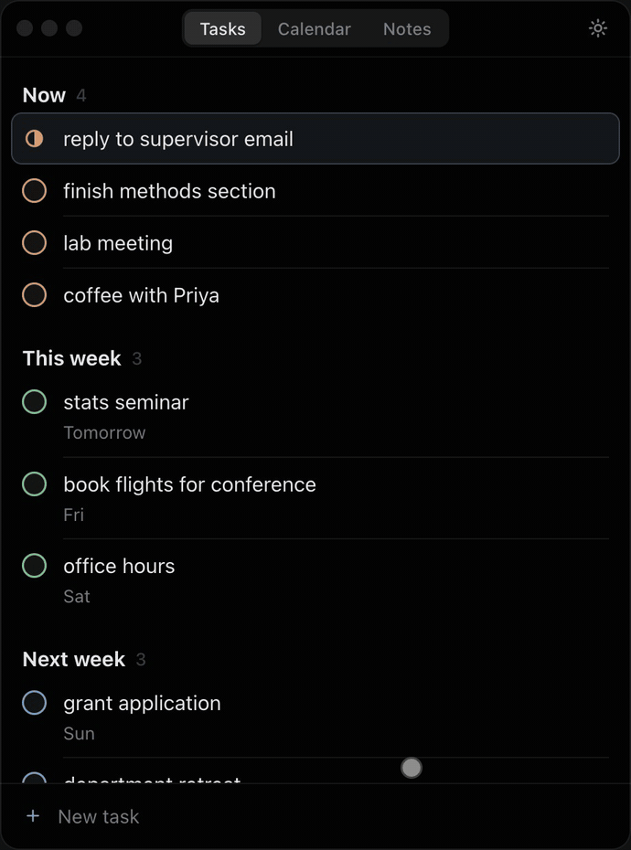

# todoish

A small macOS window that shows tasks from your Notion databases, sorted by when you need to act.

[](docs/demo.mp4)

- **Tasks**: grouped into Now, This week and Next week. Tick to finish, `n` to add.
- **Calendar**: a week strip, or a month grid with `m`.
- **Notes**: a terminal (`ls`, `cd`, `mkdir -p`, `vim <note>`) with a vim-style editor.
- **Settings**: light / dark / auto, four themes, Stay on top, open at login.

## Install

1. Download **Todoish.dmg** from [Releases](https://github.com/lovelydyna/todoish/releases) and drag the app to Applications.
2. Clear the quarantine flag (the app isn't signed):
   ```bash
   xattr -cr /Applications/Todoish.app
   ```
3. Open todoish and paste a Notion connection token.

## Notion setup

1. In Notion's developer portal, create a connection and copy its **internal connection token**.
2. Share your database with it (database `···` → Connections).
3. In todoish, pick the database and map its Status, Date, Deadline and Description properties.

## Keys

| Key | Action |
|---|---|
| `↑` `↓` | move |
| `space` | change status |
| `n` / `e` / `d` / `u` | new / edit / delete / undo |
| `c` | tasks ⇄ calendar |
| `m` | month view |
| `w` | notes |
| `,` / `?` | settings / all shortcuts |

## Build from source

Needs [Rust](https://rustup.rs) and [Node.js](https://nodejs.org) 18+.

```bash
npm install
npm run tauri build
```
